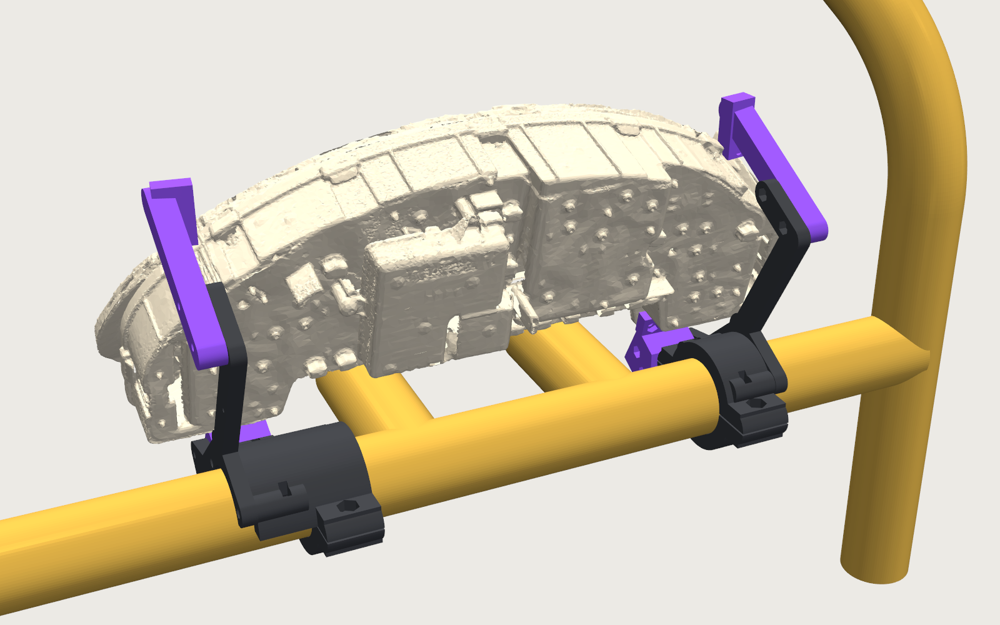
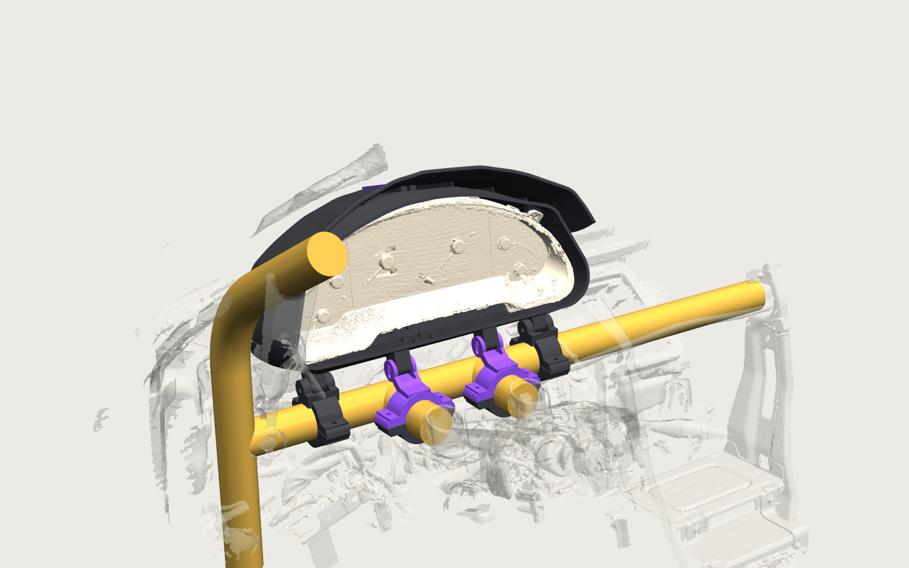

# Probe GT gauge cluster mounts

3D-printed mounts that put the stock 1993 Ford Probe GT gauge cluster on the roll cage of our 24 Hours of Lemons car.
No dash: the cluster bolts through its own factory holes into printed brackets that clamp to the dash crossbar.
Designed from a 3D scan of the cluster and the cage, generated from code, and checked for fit and wrench access before
anything is printed.

## Pick a build

| [Skeleton mount](skeleton-mount/README.md) | [Shell enclosure](shell-enclosure/README.md) |
|---|---|
|  |  |
| Bare cluster on two flat side plates and two clamps. Low, light, 10 flat parts, no supports, about 290 g. Four bolts to take it in or out of the car. | Two-piece shell with a sun brow, adjustable pitch, four clamps. Fully enclosed, 16 parts, about 1.2 kg, two 11-hour prints. |
| Geometry-checked, not yet printed. | Printed and fitted; sat high for a short driver. |

Each folder has everything you need: renders, the printable files already oriented for the bed, a bill of materials,
print settings and step-by-step assembly. A third option, a minimal shell, is coming and will get its own folder.

## What's where

```
skeleton-mount/   build option 1: README, stl/, renders/
shell-enclosure/  build option 2: README, stl/, renders/
cad/              the Python that generates both (CadQuery), the fit checks, print prep, renders, Onshape push
reference/        the scans everything is built from, and the prototype the skeleton mount came from
docs/             engineering notes: coordinate frames, what the scan got wrong, why things are the way they are
```

## Good to know

- **Left and right.** Parts named L go on the passenger side (your right when you look at the gauges), R on the
  driver side. Every part is marked: 1 dot for L, 2 dots for R.
- **Material.** ASA on a Bambu P1S, charcoal with one purple accent. Settings are in each option's README.
- **No inserts, no tapping.** Every nut sits in a printed pocket or slot; every screw is driven from the outside or
  on the bench.
- **CAD.** Everything is also in Onshape for viewing:
  [document 937c54b34f0ccb974f37f949](https://cad.onshape.com/documents/937c54b34f0ccb974f37f949). The code in `cad/`
  is the source of truth; Onshape is a viewer.

## Change something

```bash
uv venv cad/.venv && uv pip install --python cad/.venv/bin/python cadquery trimesh shapely scipy ezdxf pyvista requests rtree networkx
cad/build.sh    # regenerate geometry, run the checks, write stl/ and renders/ for both options
```

Skeleton mount: `cad/sidemount.py` (the placement is `PITCH` and `ORIGIN` at the top). Shell: `cad/generate.py` and
`cad/mount.py`. Onshape: `cad/push.py --sidemount` or `cad/push.py` (each push spends API requests, see the notes).
