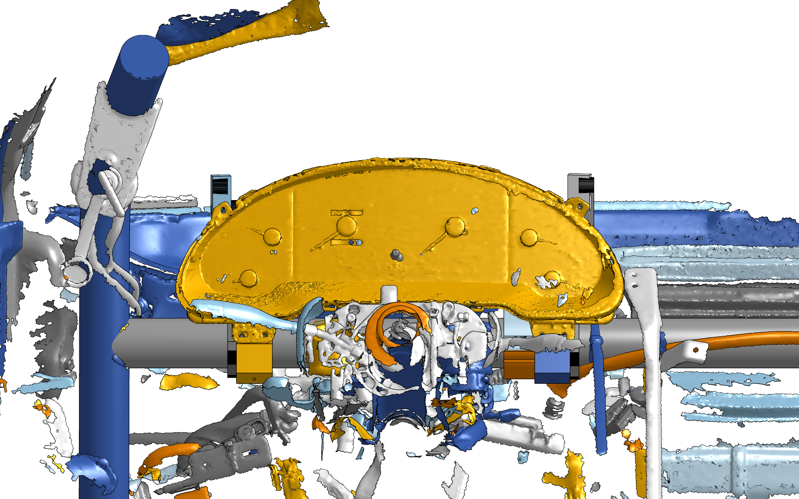
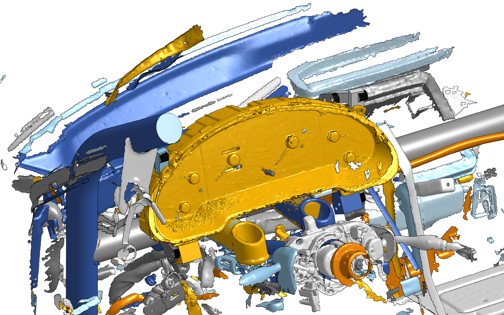
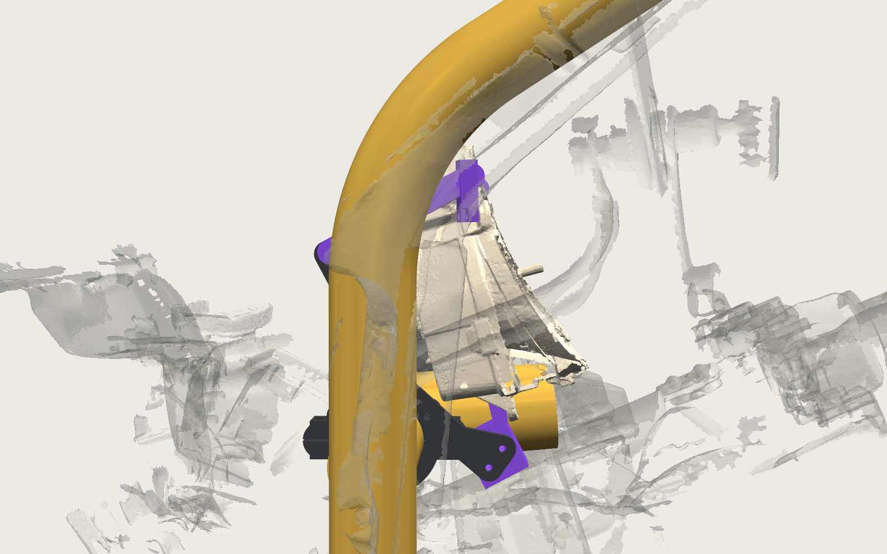
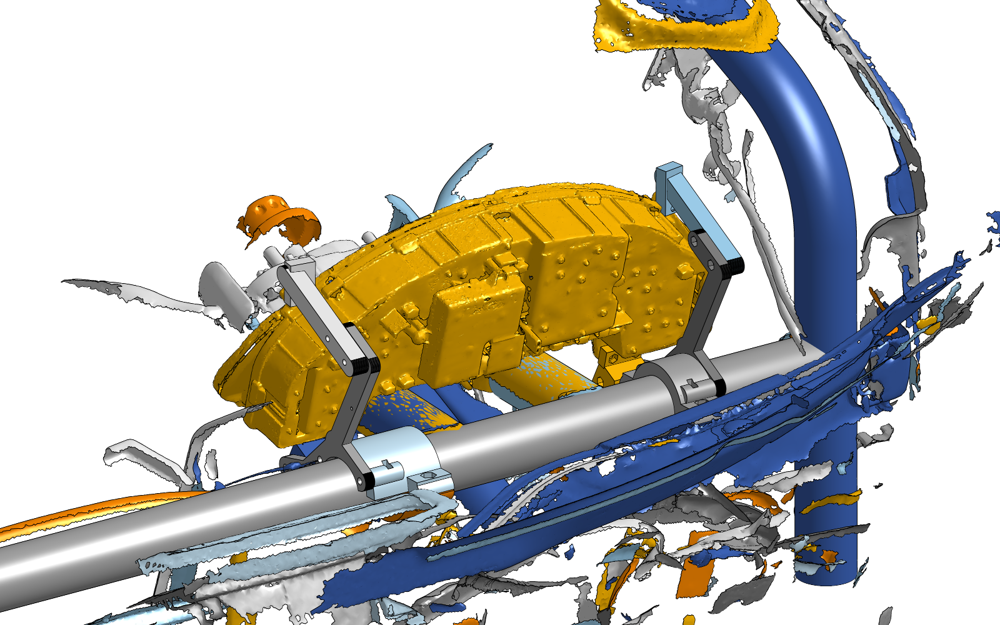
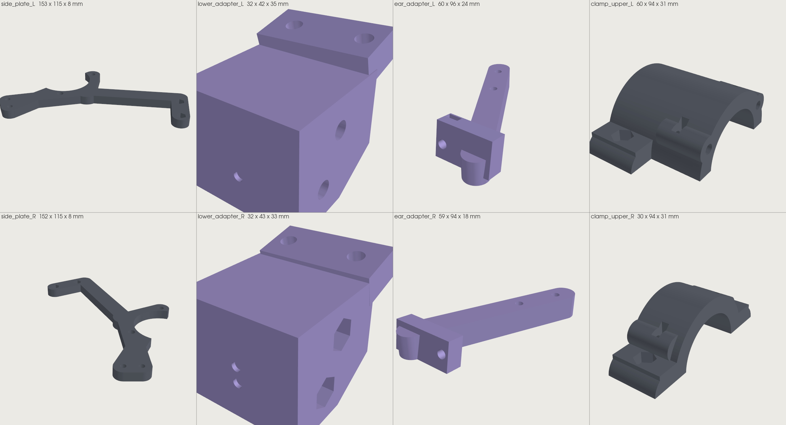

# Skeleton mount

The cluster hangs between two flat printed side plates that bolt to two split clamps on the dash crossbar. No shell, no
brow. The gauge face leans back 28°, the whole cluster sits in front of the bar, and the bezel top is 154 mm above the
bar top (the shell version reached 201). Ten printed parts, all flat, no supports, about 290 g of ASA. Everything is
assembled on the bench; in the car the only fasteners are four M6 from below.

| From the seat | In the car | The mount alone |
|---|---|---|
|  |  |  |
|  |  |  |

The Onshape views are straight from the assembly
[Side mount system (car frame)](https://cad.onshape.com/documents/937c54b34f0ccb974f37f949/w/275b479cd4996a16dce317f4/e/b8675d3e5c9e726cddb1c44a):
cage tubes, scanned dash remnants, the cluster scan and the mount. The other renders come from the generator.

## Bill of materials

Printed parts, in `stl/`, already oriented for the bed (Bambu P1S). L parts go on the passenger side (the lug plate with
round holes, on your right when you look at the gauges), R parts on the driver side; every part carries 1 dot for L,
2 dots for R.

| Part | File | g | Colour | What it is |
|---|---|---|---|---|
| Side plate L, R | [L](stl/side_plate_L.stl), [R](stl/side_plate_R.stl) | 31, 30 | charcoal | 8 mm truss behind the cluster, notched around the bar; M4 nut pockets on the inboard face |
| Clamp upper L, R | [L](stl/clamp_upper_L.stl), [R](stl/clamp_upper_R.stl) | 60, 34 | charcoal | split-clamp upper with two M5 bosses toward the plate (captured nuts, top-entry slots) and M6 nylocs captured in the flange tops; L carries a 30 mm saddle out to its plate |
| Clamp lower L, R | [L](stl/clamp_lower_L.stl), [R](stl/clamp_lower_R.stl) | 34, 34 | charcoal | plain split-clamp lower; identical to the shell version's bar-clamp lowers, reuse those if you printed them |
| Lower adapter L, R | [L](stl/lower_adapter_L.stl), [R](stl/lower_adapter_R.stl) | 29, 30 | purple | slab on the two lug plates (nuts in hex pockets from the rear) on a block that bolts to the plate |
| Ear adapter L, R | [L](stl/ear_adapter_L.stl), [R](stl/ear_adapter_R.stl) | 25, 23 | purple | block behind the ear tab (side-entry nut channel) on an arm over the housing top that laps the plate |

Hardware. Plain nuts unless marked; no heat-set inserts, no threads in plastic.

| Fastener | Qty | With | Joint | Driven from |
|---|---:|---|---|---|
| M4 x 16 socket cap | 4 | 4 M4 nuts, 4 washers (9 mm OD max) | lug plates to lower adapters | the front |
| M4 x 20 socket cap | 2 | 2 M4 nuts, 2 washers | ear tabs to ear blocks | the front, through the lens notch |
| M4 x 40 socket cap | 4 | 4 M4 nuts | lower adapters to plates | outboard |
| M4 x 25 socket cap | 4 | 4 M4 nuts | ear arms to plates | outboard |
| M5 x 25 button head (ISO 7380) | 4 | 4 M5 nuts (8 mm AF) | plates to clamp uppers | outboard |
| M6 x 30 socket cap | 4 | 4 M6 nylocs, 4 washers | clamp lowers to uppers | below |

Shopping list: 14 M4 nuts, 6 M4 washers, 4 M5 nuts, 4 M6 nylocs, 4 M6 washers, plus the bolts. Tools: 3 mm hex key,
10 mm socket on a ratchet. Do not substitute longer M6: an M6 x 40 tip reaches the cluster bottom above the driver-side
front flange.

## Print

ASA, 0.2 mm layers, 4 walls, 60 percent infill, no supports. Keep the orientation in the files: plates and ear adapters
lie on their outboard faces, lower adapters on their rear faces (the nut channels open at the bed), clamp halves on the
split face. Every part is under 1.5 hours except the passenger clamp upper (about 2). Polymaker ASA on the P1S: nozzle
255 (260 first layer), bed 100 then 95, part fan 15 percent, aux fan off, door closed, chamber preheated, dry the spool.

| File | Footprint mm | Height mm | g |
|---|---|---|---|
| side_plate_L, side_plate_R | 153 x 115 | 8 | 31, 30 |
| clamp_upper_L | 60 x 94 | 32 | 60 |
| clamp_upper_R | 30 x 94 | 32 | 34 |
| clamp_lower_L, clamp_lower_R | 30 x 94 | 32 | 34 each |
| lower_adapter_L, lower_adapter_R | 32 x 42 | 35, 33 | 29, 30 |
| ear_adapter_L, ear_adapter_R | 60 x 96 | 24, 18 | 25, 23 |

Print order: the four adapters first (they are the only scan-dependent parts; bolt them to the cluster and check the fit),
then the plates and clamps.

## Assembly

Everything on the bench except steps 6 and 7.

1. Nuts in, all press fits: four M4 in the hex pockets at the rear of each lower adapter's slab (the block top sits just
   under them), one M4 slid into each ear block's side channel from the arm's outboard face, two M4 in the pockets on
   each adapter's inboard face, two M4 in the pockets on each plate's inboard face, two M5 dropped into the slots on top
   of each clamp upper, two M6 nylocs pressed into each upper's flange pockets.
2. Cluster face down. Lower adapters onto the lug plates (L behind the round-hole plate), four M4 x 16 with washers from
   the front.
3. Plates: inboard face against the adapter block, two M4 x 40 from outboard.
4. Ear adapters: block behind the ear tab, arm on the plate's outboard face. M4 x 20 with washer from the front through
   the lens notch, two M4 x 25 from outboard through the arm into the plate.
5. Clamp uppers against the plates' inboard faces (L: the saddle end), two M5 x 25 from outboard each. Plug both ribbon
   cables in now: the passenger plug has only a few millimetres to a cage strap once installed.
6. In the car: lower the whole assembly straight down onto the crossbar. The uppers land at 134 and 375 mm from the
   driver upright and the plates' notches wrap the bar from above.
7. Lowers: the passenger lower goes straight up from below. The driver lower cannot (the dash shelf under the bar leaves
   9 mm): hook it over the bar near the driver upright, where there is 70 mm of room, and slide it along the bar to the
   upper. Four M6 x 30 with washers up from below, 10 mm socket. The nylocs are captured, nothing is needed on top.

To remove the cluster: undo the four M6 and lift. Re-torque them after the first hot day; the clamps hold pitch by
friction.

## What has been checked, and what has not

`cad/sidemount_check.py` sweeps every fastener with its tool at the stage it is driven, slides every nut along its
channel or slot, checks the M6 tips against the cluster, samples every part against every other part, the cluster scan,
the cage tubes and the dash scan, and traces the three installation moves above. All clear; the closest the plates come
to the scanned cluster is 4.6 mm (the real cluster is 2 to 3 mm deeper at the rear than the scan).

Not yet done: a print, a fit on the cluster, and a driver sitting behind it. This placement puts the cluster about
100 mm closer to the driver than the shell version and the wheel and stalks are not in the scan. Two things to watch in
the car: a flat two-hole strap on the cage just outboard of the passenger plate passes 3.6 mm from the passenger ribbon
plug body, and the clamps hold pitch by friction only.

## Changing it

`cad/sidemount.py` builds everything from constants. `PITCH` and `ORIGIN` set where the cluster sits; the truss, the
clamp positions and the adapters re-derive from them. Then run `cad/sidemount_check.py`, `cad/print_prep.py` (writes
`stl/`), `cad/render_sidemount.py` (writes `renders/`), and `cad/push.py --sidemount` to update Onshape (about 15 API
requests; `cad/onshape_views.py` fetches the shaded views, one request each). The design came from the OPEN28 prototype
in [reference/open28](../reference/open28/README.md); what changed and why is in
[docs/engineering-notes.md](../docs/engineering-notes.md).
